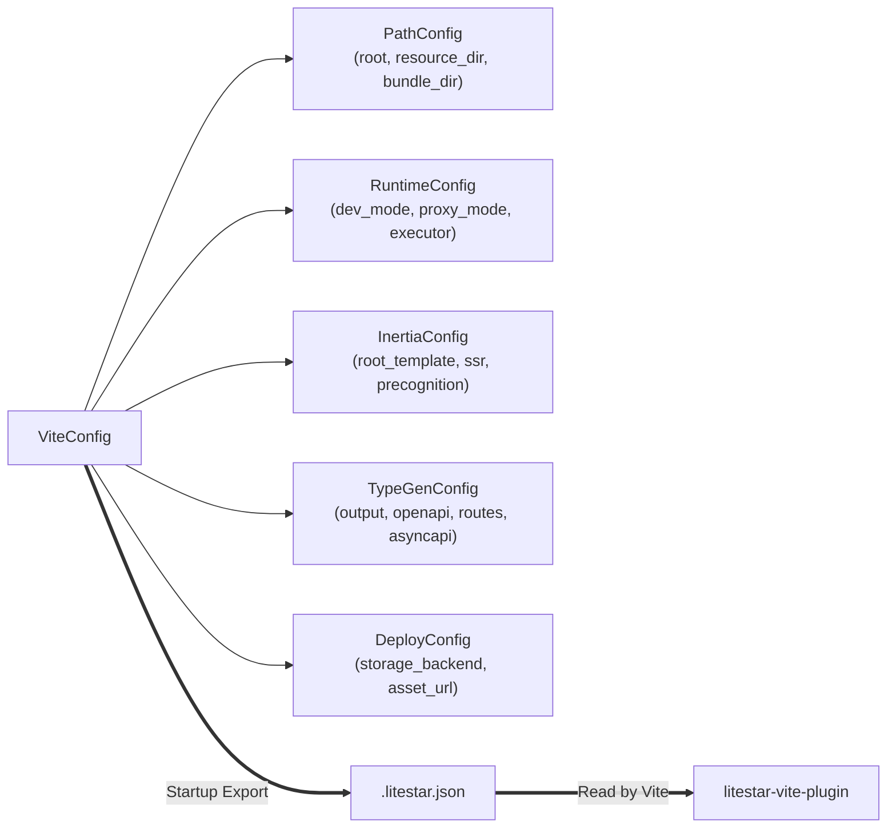

# Configuration & the `.litestar.json` Bridge

`litestar-vite` organizes its configuration into a root [`ViteConfig`](../reference/plugin-and-config.md#litestar_vite.config.ViteConfig) object backed by five focused sub-configurations. At application startup, `ViteConfig` serializes a deterministic `.litestar.json` runtime bridge file that `litestar-vite-plugin` reads automatically in TypeScript.

---

## Layered Configuration Architecture



| Config Class | Responsibility | Key Fields |
| --- | --- | --- |
| [`ViteConfig`](../reference/plugin-and-config.md#litestar_vite.config.ViteConfig) | Top-level mode, environment, and sub-config composition | `mode`, `dev_mode`, `paths`, `runtime`, `inertia`, `types`, `deploy`, `static_props` |
| [`PathConfig`](../reference/plugin-and-config.md#litestar_vite.config.PathConfig) | Filesystem layout and URL prefix resolution | `root`, `resource_dir`, `bundle_dir`, `public_dir`, `ssr_output_dir`, `asset_url`, `manifest_name`, `hot_file` |
| [`RuntimeConfig`](../reference/plugin-and-config.md#litestar_vite.config.RuntimeConfig) | Dev proxy, JS executor, subprocess management, and security | `dev_mode`, `proxy_mode`, `host`, `port`, `executor`, `start_dev_server`, `csp_nonce`, `trusted_proxies` |
| [`InertiaConfig`](../reference/plugin-and-config.md#litestar_vite.config.InertiaConfig) | Inertia.js v2 protocol, shared props, SSR, and Precognition | `root_template`, `ssr`, `use_script_element`, `precognition`, `extra_static_page_props`, `shared_page_prop_types` |
| [`TypeGenConfig`](../reference/plugin-and-config.md#litestar_vite.config.TypeGenConfig) | OpenAPI, route, Inertia page-props, and AsyncAPI codegen | `output`, `openapi_path`, `routes_path`, `page_props_path`, `schemas_path`, `generate_sdk`, `generate_routes`, `generate_channels` |
| [`DeployConfig`](../reference/plugin-and-config.md#litestar_vite.config.DeployConfig) | Cloud object storage (`fsspec`) bundle upload and CDN URLs | `enabled`, `storage_backend`, `storage_options`, `asset_url`, `delete_orphaned` |

---

## Shorthand vs. Explicit Sub-Configs

`ViteConfig` accepts convenient boolean or top-level shortcuts for rapid prototyping, and normalizes them into full sub-config instances inside `__post_init__`:

```python
from pathlib import Path
from litestar_vite import PathConfig, RuntimeConfig, TypeGenConfig, ViteConfig

simple_config = ViteConfig(
    mode="spa",
    dev_mode=True,
    types=True,
)

explicit_config = ViteConfig(
    mode="spa",
    paths=PathConfig(
        root=Path("."),
        resource_dir=Path("src"),
        bundle_dir=Path("public/build"),
        asset_url="/static/",
    ),
    runtime=RuntimeConfig(
        dev_mode=True,
        executor="pnpm",
        port=5173,
    ),
    types=TypeGenConfig(
        output=Path("src/generated"),
        generate_sdk=True,
        generate_routes=True,
    ),
)
```

---

## Environment Variable Precedence

Every runtime setting can be controlled via environment variables for container and CI deployments without modifying Python code:

| Environment Variable | Maps To | Default |
| --- | --- | --- |
| `VITE_DEV_MODE` | `RuntimeConfig.dev_mode` | `"False"` (auto-enabled when running `litestar run --reload` or `--debug`) |
| `VITE_PROXY_MODE` | `RuntimeConfig.proxy_mode` | Auto-derived from `ViteConfig.mode` (`"vite"` or `"proxy"`) |
| `VITE_HOST` | `RuntimeConfig.host` | `"127.0.0.1"` |
| `VITE_PORT` | `RuntimeConfig.port` | `5173` |
| `ASSET_URL` | `PathConfig.asset_url` | `"/static/"` |
| `VITE_DEPLOY_STORAGE` | `DeployConfig.storage_backend` | `None` |
| `VITE_DEPLOY_ASSET_URL` | `DeployConfig.asset_url` | `None` |
| `LITESTAR_TRUSTED_PROXIES` | `RuntimeConfig.trusted_proxies` | `None` (`"*"` or comma-separated CIDR/IP list) |

---

## How the `.litestar.json` Bridge Eliminates Config Drift

Without a bridge, full-stack apps duplicate `bundle_dir`, `resource_dir`, `asset_url`, and `ssr_output_dir` across both `app.py` and `vite.config.ts`. In `litestar-vite`:

1. **Python is the Single Source of Truth**: On startup (or during `litestar assets generate-types` / `litestar assets build`), Litestar writes `.litestar.json` atomically using SHA-256 `write_if_changed`.
2. **Vite Reads `.litestar.json` Automatically**: When `litestar-vite-plugin` initializes in `vite.config.ts`, it reads `.litestar.json` and configures `base`, `build.outDir`, `build.manifest`, `server.origin`, and codegen paths to match Python.
3. **Diagnostic Verification**: Run `litestar assets doctor` at any time to verify that `vite.config.ts` does not contain hardcoded overrides that conflict with `.litestar.json`. See the [Cross-Language Wire Contracts Reference](../reference/contracts.md) for the complete `.litestar.json` schema.
